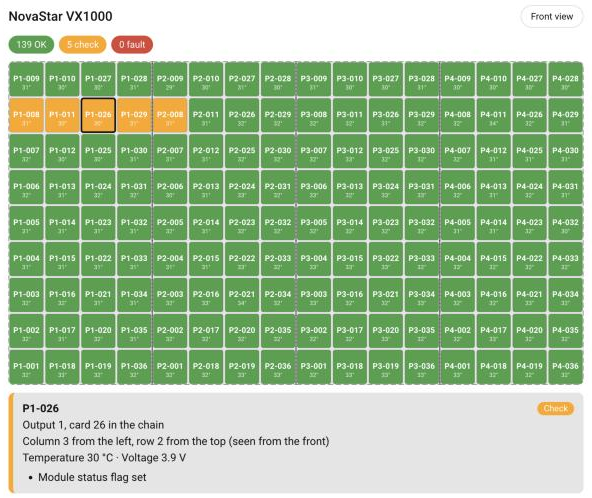

<p align="center">
  
</p>

<h1 align="center">NovaStar LED Controller for Home Assistant</h1>

<p align="center">
  <a href="https://hacs.xyz/docs/faq/custom_repositories"></a>
  <a href="https://github.com/AvenproTeam/ha-novastar-vx/releases"></a>
  <a href="https://github.com/AvenproTeam/ha-novastar-vx/actions/workflows/validate.yml"></a>
  <a href="https://github.com/AvenproTeam/ha-novastar-vx/actions/workflows/tests.yml"></a>
  <a href="LICENSE"></a>
</p>

Monitor an LED video wall driven by a **NovaStar** controller (such as the **VX1000**) from Home Assistant. You can see every receiving card (cabinet) and its temperature and voltage, find out at once when a cabinet stops answering, and know when an output has switched to its backup cable. A live **screen map** shows each cabinet where it physically sits, coloured green, yellow or red, so a technician can walk straight to the faulty one.

Made and maintained by [Avenpro](https://github.com/AvenproTeam) and shared with the community.

<p align="center">
  
</p>

## Features

- **Set up from the UI.** You only need the controller's IP address. Each Ethernet output and the cards behind it are found automatically.
- **Read-only and local.** It talks straight to the controller over your network, the same way NovaLCT does. No cloud, no account, and it never changes a setting.
- **Every cabinet monitored.** Temperature, voltage and online status for each receiving card, plus summaries per output and for the whole screen.
- **Instant fault detection.** A cabinet that stops answering (no power, broken data cable, failed card) or overheats raises a problem right away. The attributes name the exact cabinet.
- **Backup awareness.** If your outputs have backups (redundancy), a sensor tells you when an output has switched to its backup path.
- **Live screen map card.** Every cabinet is drawn where it really is on the screen and updates on each poll. Tap one to see its column, row, temperature and voltage. A **back view** mirrors the map for work from behind the screen.
- **Scales to large walls.** Per-card entities can be turned off to keep only the summaries, while the map still shows every cabinet.
- **Translated** into English, Spanish and Catalan.
- **Diagnostics download** for easy troubleshooting.

## Supported devices

| Device | Status |
| --- | --- |
| NovaStar VX1000 (with A8s-X receiving cards) | Tested |
| Other NovaStar senders and all-in-one controllers that NovaLCT reaches over LAN (VX series, MCTRL series, NovaPro…) | Should work, untested |

The integration uses NovaStar's standard register protocol, which NovaLCT uses for every sending card. If you try another model, please [open an issue](https://github.com/AvenproTeam/ha-novastar-vx/issues) and attach the diagnostics file, even if it works. That helps us extend the list.

## Requirements

- Home Assistant **2026.8** or newer.
- The controller on a network Home Assistant can reach, with its **TCP port 5200** open. You can check the controller's IP address on its front panel or in NovaLCT. A fixed IP or DHCP reservation is recommended.
- The screen already configured with NovaLCT (receiving cards mapped to outputs).

## Installation

### With HACS (recommended)

[](https://my.home-assistant.io/redirect/hacs_repository/?owner=AvenproTeam&repository=ha-novastar-vx&category=integration)

Or by hand:

1. In Home Assistant, open **HACS**, then the ⋮ menu → **Custom repositories**.
2. Add `https://github.com/AvenproTeam/ha-novastar-vx` with type **Integration**.
3. Search for **NovaStar LED Controller**, open it and select **Download**.
4. Restart Home Assistant.

### Manual

1. Download the latest release from the [releases page](https://github.com/AvenproTeam/ha-novastar-vx/releases).
2. Copy the `custom_components/novastar_vx` folder into the `custom_components` folder of your Home Assistant configuration (create it if it doesn't exist).
3. Restart Home Assistant.

## Adding a controller

[](https://my.home-assistant.io/redirect/config_flow_start/?domain=novastar_vx)

1. Go to **Settings → Devices & services → Add integration**.
2. Search for **NovaStar LED Controller**.
3. Enter the controller's IP address. Leave the port at 5200 unless you changed it.

Home Assistant then scans every output for receiving cards, which takes a few seconds. **The cards it finds become the expected layout**, so add the controller while the whole screen is powered and working. Any expected card that later stops answering is reported as a problem.

You get one device for the controller and one device per Ethernet output.

### Options

| Where | What |
| --- | --- |
| **Configure** on the integration entry | Update interval (10–3600 s, default 30 s). Card temperature alarm (default 70 °C). Whether to create entities for every card. **Scan the outputs again**: use after adding, removing or re-cabling cabinets. |
| **Reconfigure** on the integration entry | Change the controller's address. The outputs are scanned again. |

## Entities

### Controller device

| Entity | Type | Notes |
| --- | --- | --- |
| Screen problem | Binary sensor (problem) | On when any cabinet is offline or over the temperature alarm, or any output runs on backup. Attributes `cards` and `outputs_on_backup` say which. |
| Cards online | Sensor | Attributes: `expected` and `offline_cards`. |
| Highest card temperature | Sensor (°C) | Attribute `card` names the hottest cabinet. |
| Lowest card voltage | Sensor (V) | Attribute `card` names the cabinet. |
| Cards with module flag | Sensor | See [Module flag](#module-flag). |
| Connection | Binary sensor (diagnostic) | Whether the last poll reached the controller. |

### Output device (one per Ethernet output)

| Entity | Type | Notes |
| --- | --- | --- |
| Running on backup | Binary sensor (problem) | Only for outputs that have a backup configured. |
| Card problem | Binary sensor (problem) | Any cabinet on this output offline or too hot. |
| Cards online, Highest card temperature, Lowest card voltage | Sensor | Like the controller ones, for this output only. |
| Card *N* temperature / voltage / problem | Sensor / binary sensor | One set per receiving card, numbered in chain order from the output. Can be turned off in the options. |

Cabinets are named **P*output*-*card*** in attributes and on the map, for example `P2-014` is the 14th card in the chain on output 2.

## Screen map card

The card is included with the integration and loads automatically. You don't need to add a resource. Add it to any dashboard:

```yaml
type: custom:novastar-screen-card
```

Or pick **NovaStar screen map** in the card picker. It works best in a **Panel** view or a wide section.

| Option | Default | What it does |
| --- | --- | --- |
| `entry_id` | first controller | Which controller to show, if you have several. |
| `title` | controller name | Card title. |
| `view` | `front` | `back` mirrors the map left-to-right, as seen from behind the screen. You can also switch with the button on the card. |
| `labels` | `true` | Show cabinet names and temperatures on the map. |

**Colours**

| Colour | Meaning |
| --- | --- |
| 🟩 Green | Answering and within limits. |
| 🟨 Yellow | Worth a look: within 10 °C of the temperature alarm, or the module flag is set. |
| 🟥 Red, blinking | Offline (not answering) or over the temperature alarm. |
| Purple outline | That output is running on its backup. |

Cabinet positions come from the screen configuration stored in the controller (made with NovaLCT). If the controller doesn't report them, the card falls back to one row per output in chain order and tells you so.

## How it works, and what to expect

NovaStar controllers have no public API. NovaLCT talks to them over TCP port 5200 using a binary register protocol, and this integration sends the same read requests. Each poll reads:

- the controller's model and its backup (redundancy) table,
- the monitoring block of every expected receiving card (temperature, voltage, status),
- every 10 minutes, the screen layout (where each output and cabinet sits).

A full poll of 144 cards takes about 4 seconds, so the default 30 s interval is comfortable. Very large walls may want 60 s.

### What "running on backup" means

When the controller has a backup table (outputs paired as main → backup in NovaLCT), the sensor turns on if either of these happens:

- the backup output starts answering for the cards, which only happens when data reaches them that way, or
- the controller's per-output redundancy state reports an error.

This logic follows NovaLCT's behaviour, but it has only been seen in the healthy state so far. We'd love a diagnostics file captured during a real failover; see [Contributing](#contributing).

### Module flag

Each receiving card reports a 16-byte module-status block. On healthy cards its last byte is usually `0xFF`. When it isn't, the cabinet turns **yellow** and counts in **Cards with module flag**, but it isn't treated as a fault. The exact meaning of this byte isn't documented, and it may reflect configuration rather than a failure. If you see it, compare the cabinet in NovaLCT's monitoring page.

### What it can't see

Without NovaStar monitoring cards or smart modules, the controller doesn't report individual LED module health (flat cables, pixels, module temperature). The receiving card's own temperature and voltage and its online status are what's available. A dead module behind a live receiving card won't show up.

## Examples

### Notify when a cabinet fails

```yaml
automation:
  - alias: "LED screen: cabinet problem"
    triggers:
      - trigger: state
        entity_id: binary_sensor.novastar_vx1000_screen_problem
        to: "on"
    actions:
      - action: notify.notify
        data:
          title: "LED screen"
          message: >
            Cabinets: {{ state_attr('binary_sensor.novastar_vx1000_screen_problem', 'cards') }}.
            Outputs on backup: {{ state_attr('binary_sensor.novastar_vx1000_screen_problem', 'outputs_on_backup') }}.
```

### Warn when the screen runs hot

```yaml
automation:
  - alias: "LED screen: running hot"
    triggers:
      - trigger: numeric_state
        entity_id: sensor.novastar_vx1000_highest_card_temperature
        above: 60
        for: "00:05:00"
    actions:
      - action: notify.notify
        data:
          message: >
            Cabinet {{ state_attr('sensor.novastar_vx1000_highest_card_temperature', 'card') }}
            is at {{ states('sensor.novastar_vx1000_highest_card_temperature') }} °C.
```

Entity IDs depend on the device name. Check the real IDs on the device page.

## Troubleshooting

| Problem | What to check |
| --- | --- |
| "Can't reach a NovaStar controller" | Is port 5200 reachable from Home Assistant? Try `nc -vz <ip> 5200`. Check the controller's IP address and that no firewall or VLAN is in between. |
| "No receiving cards answered" | Is the screen powered and configured? Do the cards show up in NovaLCT? |
| A card shows offline but the cabinet looks fine | Its data or power may be intermittent. Or the layout changed: run **Scan the outputs again** from the options. |
| The map shows rows instead of the real layout | The controller didn't return cabinet positions. Please open an issue with the diagnostics file. |
| Temperatures read 0.5 °C steps | That's the controller's resolution. |

To see what the integration does, add this to `configuration.yaml`:

```yaml
logger:
  logs:
    custom_components.novastar_vx: debug
```

When you report a problem, please attach the file from **Download diagnostics** on the controller's device page. It holds the layout, the redundancy state and raw monitoring bytes. The IP address is redacted.

## Contributing

Bug reports, captures from other controller models, translations and pull requests are welcome. See [CONTRIBUTING.md](CONTRIBUTING.md).

## Credits

The register addresses come from [sarakusha/novastar](https://github.com/sarakusha/novastar) (MIT), a reverse-engineered NovaStar library. Many thanks to its author.

## Disclaimer

This is a community project. It is not made, endorsed or supported by Xi'an NovaStar Tech Co., Ltd. NovaStar, VX1000, NovaLCT and related names are trademarks of their owner and are used here only to identify the products this integration works with. The integration only reads data, but you use it at your own risk.

## License

[MIT](LICENSE) © Avenpro and contributors
